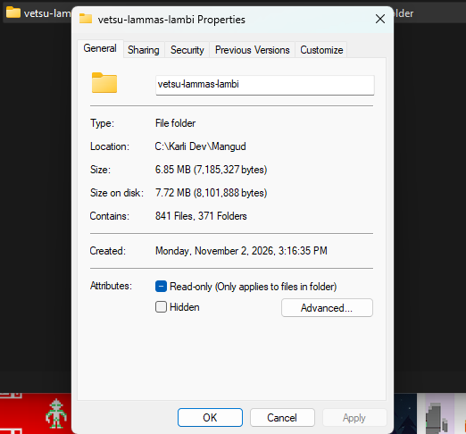
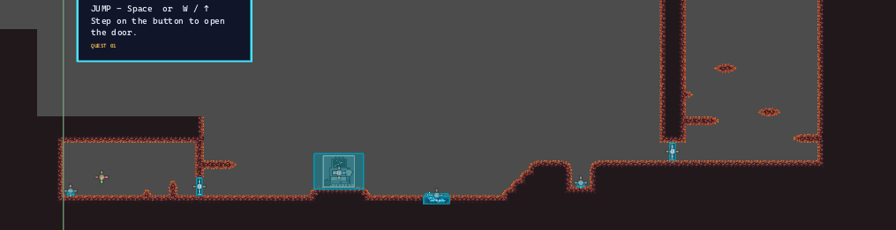
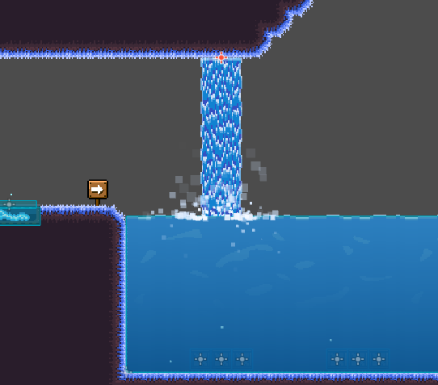
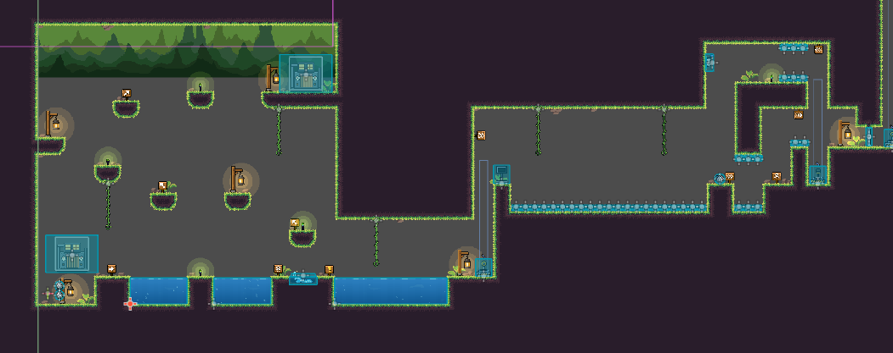
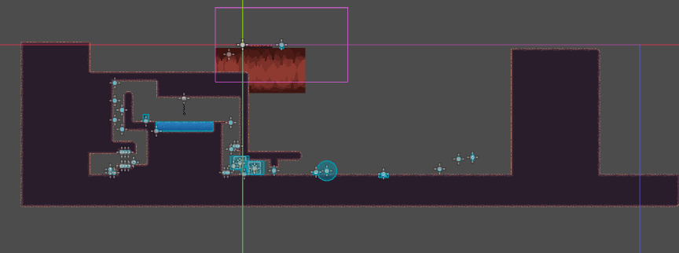

# The Development:

The day moment we started the work:

## Day 1

The exact moment we started:

The end progress of day 1:

## Day 2 

On day 2 we made a lot of advancements. We made a proper movement system. Made it more forgiving and added obstacles finally to our game. Also added some new animations and started work on the levels...

## Day 3

We continued working on the levels. We found some assets to add decors to our game and added checkpoints finally. The whole game was slowly coming together. We also added some secrets into levels for the players to find. Once they had finished the game.

### Added water with physics and a waterfall aswell

